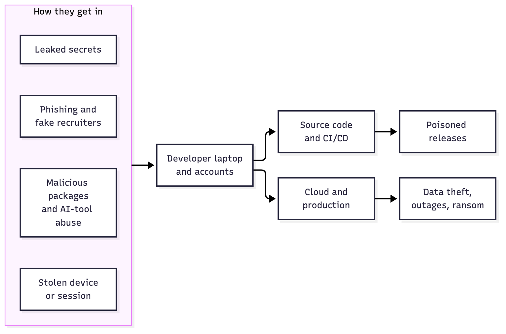

  

# Security Handbook for Developers

**Practical, opinionated security habits for people who write and ship code.**

*"Hackers don't break in. They walk through the door you left open."*

---

## Who this is for

Developers and small engineering teams, especially those handling secrets, infrastructure, or money (crypto, fintech). Each chapter explains the threat, shows a real incident, and gives you steps you can do today.

## Threat model in one minute

Attackers rarely beat your production defenses head-on. They go after the developer, because a developer's laptop, accounts and tokens lead everywhere.

The handbook is organized around cutting each arrow: harden the endpoint (I), filter what comes in (II, VI), secure the pipeline (III), limit what a stolen identity can reach (IV), assume it will still happen (V), and fix the human and process gaps (VII).

## Start here: the 12 highest-impact actions

If you only do a dozen things, do these.

- [ ] Put a **passphrase or hardware key** on every SSH key ([1.1](docs/01-identity-and-workstation.md#1-ssh-keys))
- [ ] **Sign your commits** ([1.2](docs/01-identity-and-workstation.md#2-signed-commits))
- [ ] Use a **password manager**, unique passwords, and **hardware-key or passkey MFA** ([1.3](docs/01-identity-and-workstation.md#3-passwords-mfa-and-passkeys))
- [ ] **Stop keeping secrets in `.env` files**. Inject them at runtime ([1.5](docs/01-identity-and-workstation.md#5-keep-secrets-out-of-env-files))
- [ ] **Vet every new dependency** and commit your lockfiles ([2.1](docs/02-supply-chain.md#1-dependencies))
- [ ] **Never run secrets or `--privileged`** in containers ([2.2](docs/02-supply-chain.md#2-docker-and-containers))
- [ ] **Don't open unexpected files** from chat or email ([2.4](docs/02-supply-chain.md#4-malicious-files-and-pdfs))
- [ ] **Pin CI actions to SHAs** and use OIDC instead of stored cloud keys ([3.1](docs/03-devsecops.md#1-cicd-pipelines))
- [ ] Remove **standing production access**. Use JIT ([4.2](docs/04-access-and-infrastructure.md#2-just-in-time-jit-privileges))
- [ ] Run **AI agents with approvals on**, and verify every package they suggest ([6](docs/06-ai-assisted-development.md))
- [ ] Never run a **recruiter's "coding challenge"** on your real machine ([7.1](docs/07-people-and-process.md#1-fake-recruiters-and-coding-challenges))
- [ ] Know **who to call and what to revoke** when something goes wrong ([5.2](docs/05-detect-and-respond.md#2-incident-response))

## Contents

| Part | Topics |
|------|--------|
| **[I. Developer Identity & Workstation](docs/01-identity-and-workstation.md)** | SSH keys and YubiKey · signed commits · passwords, MFA and passkeys · secrets sharing · `.env` files · firewalls · device monitoring |
| **[II. Supply Chain & Dependencies](docs/02-supply-chain.md)** | Package attacks · Docker hardening · fake download sites · malicious PDFs and files |
| **[III. DevSecOps & Shift-Left](docs/03-devsecops.md)** | CI/CD security · secure coding · SAST, DAST, SCA and secret scanning |
| **[IV. Access & Infrastructure](docs/04-access-and-infrastructure.md)** | VPN and MFA · just-in-time privileges · cloud security |
| **[V. Detect & Respond](docs/05-detect-and-respond.md)** | Logging and alerting · incident response · runbooks (leaked secret, bad dependency, lost laptop, cloud compromise) |
| **[VI. AI-Assisted Development](docs/06-ai-assisted-development.md)** | Prompt injection · malicious MCP servers and rules files · hallucinated packages · secrets in prompts · agent permissions |
| **[VII. People & Process](docs/07-people-and-process.md)** | Fake recruiters · social engineering · SIM-swap and account recovery · onboarding and offboarding |

**Copyable checklists:** [onboarding](checklists/onboarding.md) · [offboarding](checklists/offboarding.md)

## How to read it

Each chapter follows the same shape: **threat → real incident → what to do**. Every part shows a *last reviewed* date, and security advice ages quickly, so check it. Chapters are independent, so read in order or jump to what's relevant.

## Contributing

Corrections and additions are welcome. Open an issue or pull request. Please:

- Link to a primary source for every incident or statistic.
- Prefer concrete commands and config over general advice.
- Keep the tone direct and plain.

## License

[CC BY 4.0](LICENSE). Share and adapt with attribution.

Screenshots prefixed `gh-` in `assets/` come from [GitHub Docs](https://docs.github.com), which is also licensed CC BY 4.0.
