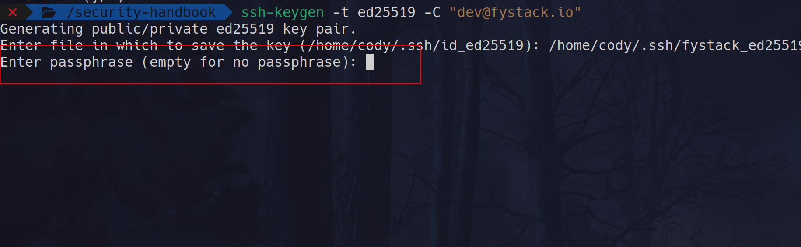
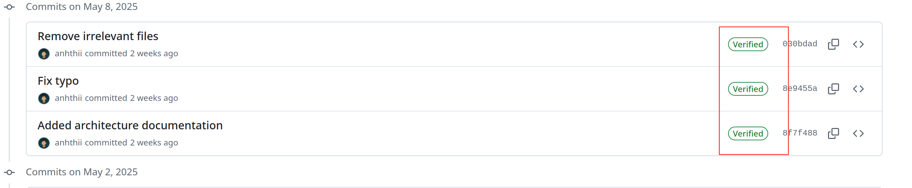
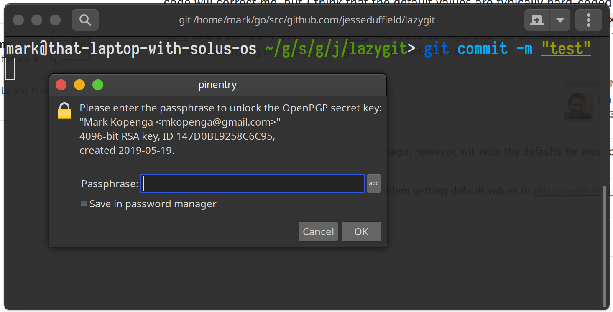
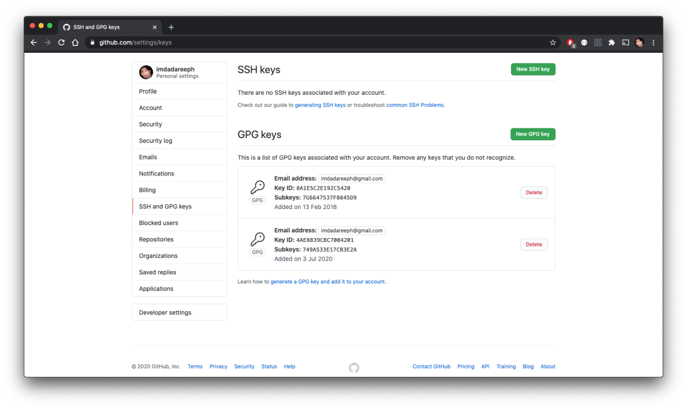
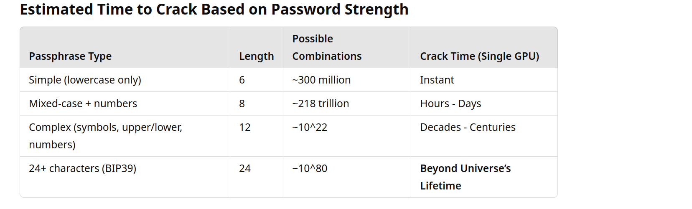
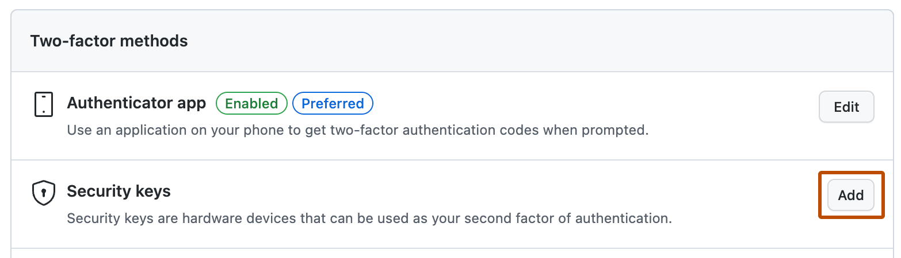

# Part I: Developer Identity & Workstation

> Threats that start at the endpoint: your laptop, your keys, your credentials. If an attacker owns the developer, the rest of the defenses barely matter.

_Last reviewed: 2026-10_

[← Back to handbook](../README.md) · [Next: Supply Chain →](02-supply-chain.md)

**In this part**

1. [SSH keys](#1-ssh-keys)
2. [Signed commits](#2-signed-commits)
3. [Passwords, MFA and passkeys](#3-passwords-mfa-and-passkeys)
4. [Never share secrets](#4-never-share-secrets)
5. [Keep secrets out of `.env` files](#5-keep-secrets-out-of-env-files)
6. [Firewall policy for developer desktops](#6-firewall-policy-for-developer-desktops)
7. [Detect compromised developer devices](#7-detect-compromised-developer-devices)

---

## 1. SSH keys

An SSH private key without a passphrase is a plaintext credential. Anyone who copies the file (malware, a backup leak, a stolen laptop) can act as you on GitHub and every server your key reaches: push code, read private repos, log in to production.



Automated scanners already hunt for unprotected keys, for example the [SSH key scan honeypot attack](https://www.ssh.com/blog/ssh-key-scan-attack-honeypot).

### Baseline

- Always set a passphrase. Use a long random one or a passphrase of several unrelated words, stored in your password manager.
- Use Ed25519: `ssh-keygen -t ed25519 -C "you@company.com"`.
- Load keys through `ssh-agent` (on macOS, `ssh-add --apple-use-keychain`) so you don't retype the passphrase.
- One key per device. Never copy a private key between machines.
- Rotate or revoke a key when a device is lost, an employee leaves, or you suspect exposure. Calendar-based rotation (e.g. monthly) adds friction without much benefit for passphrase-protected keys. Short-lived credentials (see [JIT privileges](04-access-and-infrastructure.md#2-just-in-time-jit-privileges)) are the better fix for long-lived access.

### Best: keep the key on a hardware token (YubiKey / FIDO2)


A passphrase-protected key still lives on disk, so malware that runs as you can copy it and try to crack or keylog the passphrase. A FIDO2 key (`-sk` type) keeps the secret inside the token. Every use needs a physical touch.

Why this is the strongest option for GitHub:

- The private key can't be exported, so malware can't exfiltrate it.
- Touch-to-authenticate stops remote abuse even if the machine is compromised.
- Works with OpenSSH 8.2+. No extra agent needed.
- The same key can sign commits (`gpg.format ssh`), so both auth and signing are hardware-backed.

Generate a resident key on the YubiKey:

```bash
ssh-keygen -t ed25519-sk -O resident -O application=ssh:github -O verify-required -C "github-yubikey"
```

| Flag | Effect |
|------|--------|
| `-t ed25519-sk` | Hardware-backed Ed25519 key |
| `-O resident` | Key can be re-imported on any machine with `ssh-keygen -K` |
| `-O verify-required` | Requires the token PIN *and* a touch on every use |

Use this key only for GitHub:

```bash
git config --global core.sshCommand 'ssh -i ~/.ssh/id_ed25519_sk -o IdentitiesOnly=yes'
```

`IdentitiesOnly=yes` stops SSH from offering your other keys to the server. Then add `id_ed25519_sk.pub` under **GitHub → Settings → SSH and GPG keys**.

> **Recovery:** enroll **two** tokens up front and keep the second one somewhere safe. Losing your only key means being locked out of your own repos.

Full walkthrough: [YubiKey + SSH + Git](https://medium.com/@harrishcluo/yubikey-ssh-git-super-secure-your-development-workflow-2-2-1899379fb882)

---

## 2. Signed commits

Git author metadata is not authenticated. Anyone can run:

```bash
git commit --author="You <you@domain.com>" -m "Awesome new feature"
```

A forged commit lets an attacker:

- **Pass off malicious code** as a trusted contributor's work.
- **Corrupt the audit trail**, so `git blame` points at the wrong person.
- **Trigger pipelines** that deploy backdoors or leak secrets.

Signing proves a commit came from a key you control. GitHub shows a **Verified** badge:



With a passphrase-protected GPG key you enter the passphrase to sign:



Combined with an SSH key for pushing, you get two independent factors: one to push, one to sign.

Add your public key under GitHub account settings:



Recommendations:

- Give GPG keys an expiry (about 3 months to 1 year) and renew them.
- SSH signing (`git config gpg.format ssh`) is simpler than GPG and works with the YubiKey setup above.
- Turn on **Vigilant mode** in GitHub settings so unsigned commits under your name are flagged.
- Require signed commits with branch protection on important repos.

---

## 3. Passwords, MFA and passkeys

Weak and reused passwords remain a leading cause of account takeover.



**Use a password manager.** Bitwarden, 1Password, or KeePassXC. Never keep passwords in notes, spreadsheets, or browser autofill. Protect the manager itself with a strong master passphrase and a hardware key.

**Use a unique, random password per service.** Let the manager generate it (16+ characters). Don't use dictionary words or personal details.

**Rotate on events, not on a calendar.** Change a password when there is a breach, suspected exposure, or a staff change. Forced periodic rotation tends to produce weaker passwords ([NIST SP 800-63B](https://pages.nist.gov/800-63-3/sp800-63b.html) recommends against it). Do rotate long-lived machine credentials such as database passwords and API keys on a schedule, ideally automatically.

**Enable MFA everywhere, and prefer phishing-resistant factors.**

| Factor | Phishing resistance |
|--------|---------------------|
| Hardware key / passkey (FIDO2) | Strong |
| Authenticator app (TOTP) | Medium |
| SMS | Weak, vulnerable to SIM swap |

Adding a security key in GitHub's 2FA settings:



*Screenshot: [GitHub Docs](https://docs.github.com/en/authentication/securing-your-account-with-two-factor-authentication-2fa/configuring-two-factor-authentication), CC BY 4.0.*

**Prefer passkeys** (WebAuthn) wherever supported (Google, Apple, GitHub, Microsoft). They are bound to the real domain, so a look-alike phishing site can't capture them.

Prioritize these accounts: GitHub, Google/Workspace, cloud consoles, password manager, domain registrar, email, and anything that touches money (exchanges, wallets, payments).

---

## 4. Never share secrets

Don't send private keys, API secrets or passwords to anyone, including teammates, and never over chat or email.

- **Give access, not secrets.** Use role-based access control and a secrets manager so each person has their own identity and permissions.
- **Rotate after any exposure**, and automate rotation where possible.
- **Shared credentials destroy attribution.** If three people know a key and it leaks, you can't tell who leaked it, and you can't tell which component an attacker pivoted from.

If a secret was pasted into Slack, a ticket, or a commit, treat it as compromised and rotate it. Deleting the message is not enough.

---

## 5. Keep secrets out of `.env` files

Plain `.env` files are convenient and risky:

- They get committed to Git by accident.
- Anyone (or any malware) with access to the laptop can read them.
- They have no access control, no audit log, and no rotation.

Recommended: fetch secrets at runtime from a secrets manager and inject them into the process, never onto disk.

| Tool | Example |
|------|---------|
| 1Password CLI | `op run --env-file=.env.tpl -- npm start` |
| Doppler | `doppler run -- npm start` |
| Infisical | `infisical run -- npm start` |
| HashiCorp Vault | `vault kv get -field=password secret/myapp/db` (or Vault Agent / `envconsul` for env injection) |
| SOPS + age | Encrypted secrets files that are safe to commit |

Example with a template that holds only references, not values (1Password):

```bash
# .env.tpl, safe to commit
DB_USERNAME=op://dev/postgres/username
DB_PASSWORD=op://dev/postgres/password
```

```bash
op run --env-file=.env.tpl -- ./my_command
```

Also:

- Add `.env*` to `.gitignore`, and keep a `.env.example` with placeholder values.
- Run a secret scanner as a pre-commit hook (see [Security testing](03-devsecops.md#3-security-testing)).
- Use short-lived, scoped credentials in development. Never use production secrets locally.

---

## 6. Firewall policy for developer desktops

Developer machines hold credentials, API access and infrastructure reach. A host firewall limits what malware can do and what the network can reach.

- **Inbound:** deny by default. Open only what you actually serve.
- **Outbound:** an application-level firewall shows (and lets you block) unexpected connections, a good way to catch malware phoning home.
- **Logging:** keep logs enabled and review them occasionally.
- **Review rules periodically.** Remove ones you no longer need.

Tools:

- macOS: built-in Application Firewall, [Little Snitch](https://obdev.at/products/littlesnitch/) or [LuLu](https://objective-see.org/products/lulu.html) for outbound control
- Linux: [UFW](https://www.digitalocean.com/community/tutorials/how-to-set-up-a-firewall-with-ufw-on-ubuntu), [OpenSnitch](https://ostechnix.com/opensnitch-application-level-firewall-for-linux/)
- Windows: Windows Defender Firewall

---

## 7. Detect compromised developer devices

Even if your backend is locked down, one infected laptop with Git credentials or VPN access can undo it.

- **Run EDR** such as CrowdStrike or SentinelOne, or open-source [Wazuh](https://wazuh.com/).
- **Avoid long-lived cached tokens** in CLIs like `gh` and `aws`. Use SSO with short sessions.
- **Limit SSH agent forwarding.** Prefer `ProxyJump` over `ForwardAgent` for bastion hosts.
- **Use a VPN on untrusted networks**, and enforce it on laptops with privileged access.
- **Full-disk encryption and automatic screen lock** on every device.
- **Keep the OS and browsers updated.**

---

[← Back to handbook](../README.md) · [Next: Supply Chain →](02-supply-chain.md)
