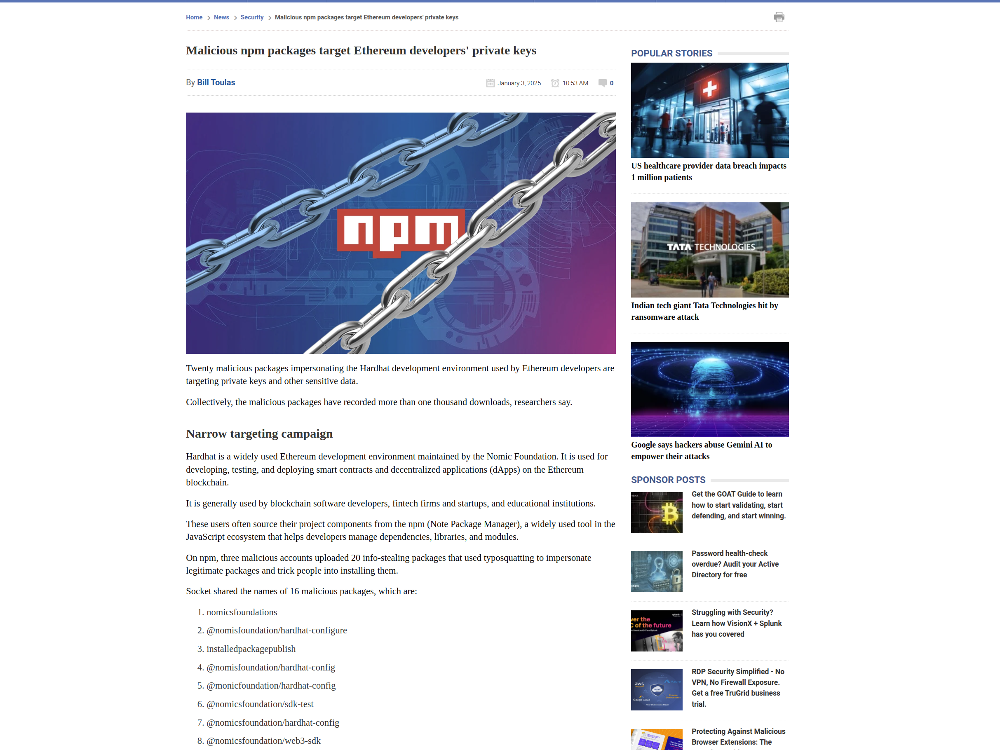
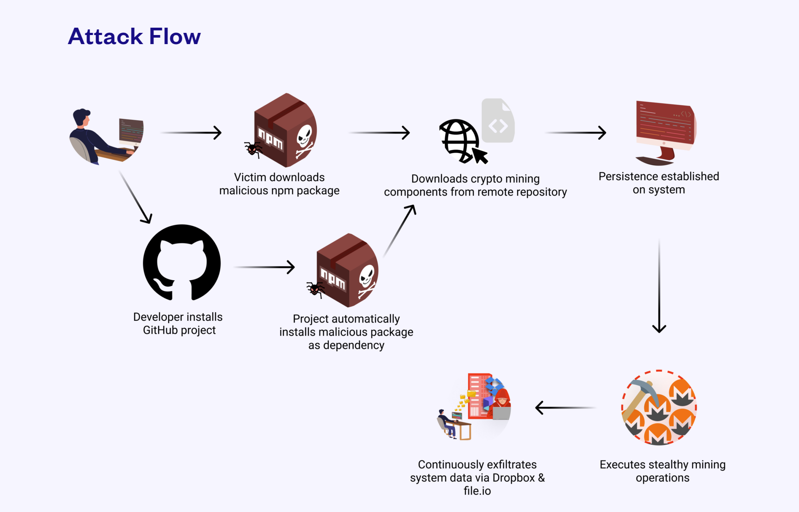
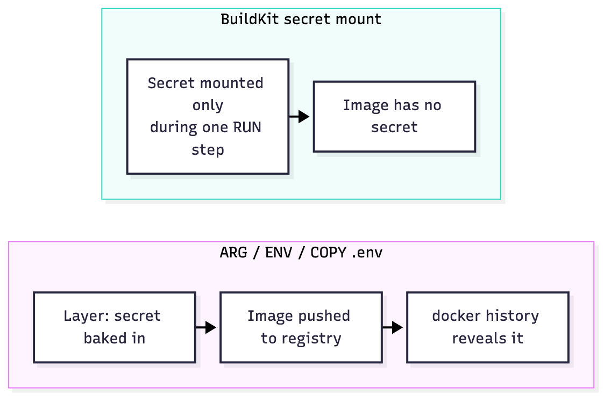
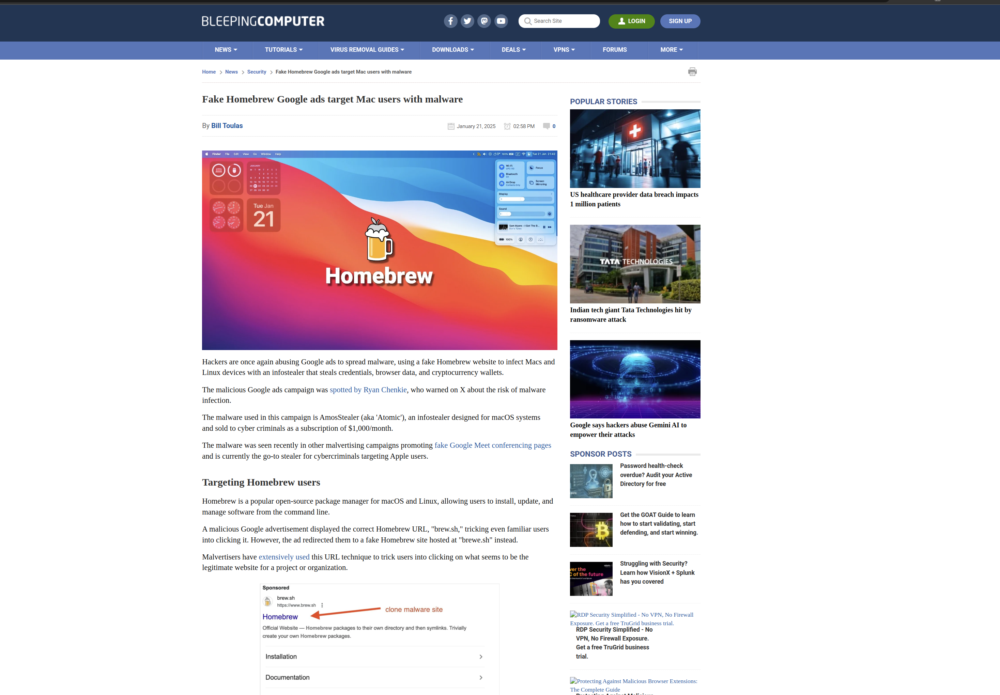
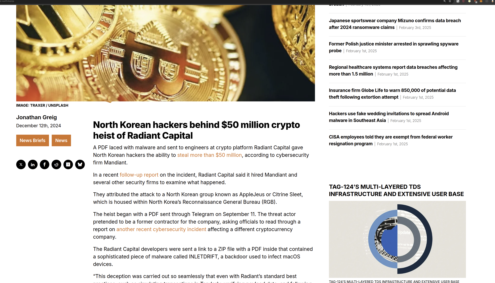
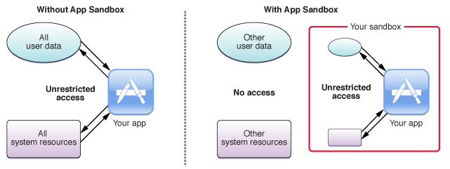
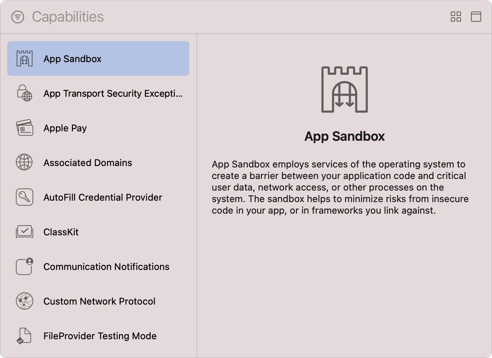

# Part II: Supply Chain & Dependencies

> Everything that enters your machine from outside: packages, images, downloads, attachments. This inbound trust boundary is where modern attacks land first.

_Last reviewed: 2026-10_

[← Identity & Workstation](01-identity-and-workstation.md) · [Back to handbook](../README.md) · [Next: DevSecOps →](03-devsecops.md)

**In this part**

1. [Dependencies](#1-dependencies)
2. [Docker and containers](#2-docker-and-containers)
3. [Downloads and look-alike sites](#3-downloads-and-look-alike-sites)
4. [Malicious files and PDFs](#4-malicious-files-and-pdfs)

---

## 1. Dependencies

Every `npm install` runs code written by strangers, often with install scripts that execute immediately. One bad package can read your SSH keys, cloud credentials and wallet files.



### Recent incidents

- [Malicious npm packages target Ethereum developers' private keys](https://www.bleepingcomputer.com/news/security/malicious-npm-packages-target-ethereum-developers-private-keys/)
- [Hackers deploy malicious npm packages targeting crypto users](https://thehackernews.com/2025/01/hackers-deploy-malicious-npm-packages.html)
- [Ripple's xrpl.js npm package backdoored](https://thehackernews.com/2025/04/ripples-xrpljs-npm-package-backdoored.html)
- [Malicious Python package steals Ethereum private keys](https://www.scworld.com/brief/malicious-python-package-found-stealing-ethereum-private-keys)
- [Malicious npm package steals TON wallet keys](https://socket.dev/blog/ton-wallet-security-threat-malicious-npm-package-steals-cryptocurrency-wallet-keys)
- [Trojanized Go BoltDB module went undetected for 3+ years](https://www.theregister.com/2025/02/04/golang_supply_chain_attack/)

### Common attack patterns

| Pattern | How it works |
|---------|--------------|
| **Typosquatting** | A package with a near-identical name (`reqeusts` for `requests`) |
| **Maintainer compromise** | A trusted maintainer's account is hijacked and a poisoned release is published |
| **Dependency confusion** | A public package with the same name as your internal one wins version resolution |
| **Install-script malware** | `preinstall`/`postinstall` hooks run code as soon as you install |
| **Obfuscated payloads** | Minified or compiled code hides credential-stealing logic |



### Before you add a dependency

1. **Check the source.** Official registry, expected maintainer, real linked repo, sensible download count and age. Watch for names one character off.
2. **Read what it does at install time.** Look for install scripts and unexpected network calls. Tools like [Socket](https://socket.dev) automate this.
3. **Pin and commit lockfiles** (`package-lock.json`, `pnpm-lock.yaml`, `go.sum`, `poetry.lock`) and install with `npm ci` in CI.
4. **Review the tree**, not just the top-level package: `npm ls`, `go mod graph`, `pipdeptree`.
5. **Audit continuously:** `npm audit`, `pip-audit`, Dependabot or Renovate.

### Hardening defaults

```bash
# Don't run dependency install scripts unless you allow them
npm config set ignore-scripts true

# pnpm: only listed packages may run build scripts
# (package.json -> "pnpm": { "onlyBuiltDependencies": ["esbuild"] })
```

- Delay adopting brand-new releases (e.g. Renovate `minimumReleaseAge`). Most malicious versions are pulled within days.
- Scope internal packages (`@yourorg/*`) and reserve the scope on the public registry to prevent dependency confusion.
- Install and build in a container or VM when evaluating unfamiliar code.

**Team process:** new dependencies need review before merge. Check the maintainer and history (`npm info <package>`, `pip index versions <package>`).

---

## 2. Docker and containers

A container is not a sandbox unless you configure it as one. Exposed daemons and misconfigured images are a steady source of breaches.

| Incident | What happened |
|----------|---------------|
| [Tesla Kubernetes (2018)](https://arstechnica.com/information-technology/2018/02/tesla-cloud-resources-are-hacked-to-run-cryptocurrency-mining-malware/) | Open Kubernetes dashboard used to run cryptominers |
| [Docker Hub breach (2019)](https://thehackernews.com/2019/04/docker-hub-data-breach.html) | Registry breach exposed about 190,000 accounts |
| [Graboid (2019)](https://unit42.paloaltonetworks.com/graboid-first-ever-cryptojacking-worm-found-in-images-on-docker-hub/) | First cryptojacking worm spread via exposed Docker daemons |
| [TeamTNT (2020-21)](https://www.bleepingcomputer.com/news/security/teamtnt-hackers-target-your-poorly-configured-docker-servers/) | Unauthenticated Docker APIs used to mine crypto and steal credentials |
| [Kinsing (2020)](https://www.aquasec.com/blog/threat-alert-kinsing-malware-container-vulnerability/) | Exposed Docker APIs used to deploy miners and scan for SSH keys |
| [Dero miner (2025)](https://www.techradar.com/pro/security/misconfigured-docker-instances-are-being-hacked-to-mine-cryptocurrency) | Worm spread through misconfigured Docker instances |

### Best practices

**1. Don't run as root.** Avoid `--privileged` and don't mount `/proc`, `/sys` or `/dev`.

```dockerfile
# ✅ Create and use an unprivileged user
RUN useradd -m appuser
USER appuser
```

**2. Use minimal base images.** Fewer packages means a smaller attack surface. Prefer distroless, `alpine`, or `scratch`.

```dockerfile
FROM alpine:3.20
```

**3. Scan images** before deploying with [Trivy](https://github.com/aquasecurity/trivy) and lint them with [Dockle](https://github.com/goodwithtech/dockle).

**4. Sign and verify images** with [Cosign](https://github.com/sigstore/cosign). Pin base images by digest (`FROM alpine@sha256:...`).

**5. Keep secrets out of images.** Don't `COPY .env` or `.aws/` into an image. `ARG` and `ENV` values are stored in image layers and visible with `docker history`, so they are **not** safe for secrets either. Use BuildKit secret mounts at build time and inject runtime secrets from your secrets manager:

```dockerfile
# ❌ Baked into the image
COPY .env /app/.env
ARG API_KEY
ENV API_KEY=$API_KEY

# ✅ Available only during this RUN step, never stored in a layer
RUN --mount=type=secret,id=api_key \
    API_KEY="$(cat /run/secrets/api_key)" ./build.sh
```

```bash
docker build --secret id=api_key,src=./api_key.txt .
```

Add a `.dockerignore` that excludes `.env`, `.git` and credentials.



**6. Limit network exposure.** Publish ports to localhost unless they must be public, and put inter-container traffic on internal networks. Never expose the Docker daemon socket (`/var/run/docker.sock`) or TCP port 2375 to a network or into a container.

```bash
docker run -p 127.0.0.1:8080:80 myapp
```

**7. Limit resources and capabilities.**

```bash
docker run --memory=256m --cpus=0.5 --read-only \
  --cap-drop=ALL --security-opt=no-new-privileges myapp
```

**8. Patch the daemon and host.** Consider container-focused host OSes like Bottlerocket or Flatcar.

**9. Add runtime protection.** [Tetragon](https://github.com/cilium/tetragon) or [Falco](https://falco.org/) for syscall-level detection; [gVisor](https://gvisor.dev/) or [Kata Containers](https://katacontainers.io/) for stronger isolation.

---

## 3. Downloads and look-alike sites

Attackers buy ads and register look-alike domains so that "first search result" delivers malware. Even Homebrew has been [impersonated in Google ads](https://www.bleepingcomputer.com/news/security/fake-homebrew-google-ads-target-mac-users-with-malware/).



### How you get hooked

- **Malicious ads** appear above real results with official-looking logos.
- **Typosquatted domains:** `node-js.org` instead of `nodejs.org`, or `g1thub.com` instead of `github.com`.
- **SEO poisoning:** fake sites rank for "download <tool>".

### Defense

1. **Don't use search results for downloads.** Bookmark the official site, or use the project's README or GitHub release page.
2. **Prefer package managers** over manual downloads:

   ```bash
   brew install node        # macOS
   apt install nodejs       # Debian/Ubuntu
   ```

3. **Read the URL character by character** before you paste a command or download anything. Don't pipe unknown scripts into a shell (`curl ... | sh`). Download, read, then run.
4. **Verify integrity.** Compare published checksums or signatures (`shasum -a 256`, `gpg --verify`, `cosign verify`).
5. **Don't rely on the padlock.** HTTPS only means the connection is encrypted. Phishing sites have valid certificates too.
6. **Detonate suspicious files** in a VM or on [VirusTotal](https://virustotal.com) before opening them. A clean scan isn't proof of safety.
7. **Block known-bad domains** with DNS filtering such as Cloudflare Gateway or `1.1.1.2` (malware blocking).

### Case studies

| Attack | Year | Method |
|--------|------|--------|
| PyPI `pytorch-nightly` look-alike (`torchtriton`) | 2022 | Dependency-confusion package that exfiltrated data |
| Fake VLC, Notepad++ and Brave ads | 2023 | Malvertising pointing to trojanized installers |
| `ua-parser-js` hijack | 2021 | Maintainer account compromised, malware in new versions |

### Checklist

- [ ] Is this the official site or repo?
- [ ] Did I read the full URL?
- [ ] Can I install it from `brew`, `apt` or another package manager instead?
- [ ] Did I verify a checksum or signature?
- [ ] If in doubt, did I ask the team?

---

## 4. Malicious files and PDFs

Attackers send "job offers", "contracts" and "invoices" over email, Telegram and Discord, and wait for one person to open them.



Real examples: the 2022 **Ronin Bridge** hack (about $615M) began with a fake job offer delivered to an engineer, and the 2024 **Radiant Capital** hack (about $50M) began with malware in a PDF sent over Telegram from a spoofed contractor. Both involved a single person opening a file.

### Rules

- **Treat unexpected files as hostile**, especially from new contacts. Verify with the sender through a second channel.
- **Preview instead of download.** Open email attachments in the browser (Gmail or Drive preview) rather than saving and opening them locally.
- **Don't enable macros, "enable editing", or run any file** that asks you to install a viewer or font.
- **Be wary of archives and executables** disguised as documents (`invoice.pdf.exe`, `.dmg`, `.iso`, `.lnk`). Show file extensions.
- **Report suspicious files** to your security contact **before** interacting with them.
- **Keep your PDF reader and OS patched.**

### Open untrusted files in a sandbox

[Application sandboxing](https://www.techtarget.com/searchmobilecomputing/definition/application-sandboxing) limits what a compromised app can touch.

| OS | Option |
|----|--------|
| Windows | [Windows Sandbox](https://learn.microsoft.com/en-us/windows/security/application-security/application-isolation/windows-sandbox/) (built in, disposable) |
| Linux | [Firejail](https://firejail.wordpress.com/) |
| macOS | A disposable VM (UTM, Parallels). The App Sandbox is a developer-facing mechanism for apps you build, not a switch for opening untrusted files. |





---

[← Identity & Workstation](01-identity-and-workstation.md) · [Back to handbook](../README.md) · [Next: DevSecOps →](03-devsecops.md)
