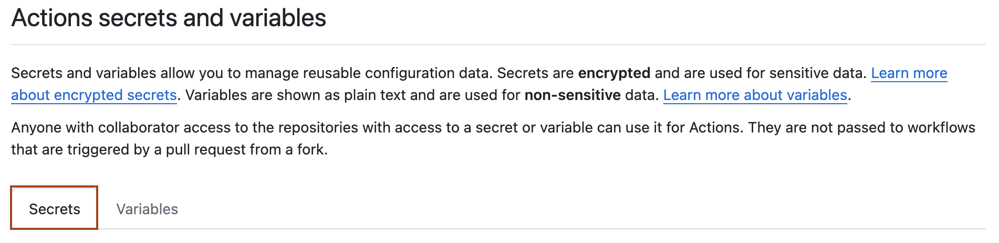
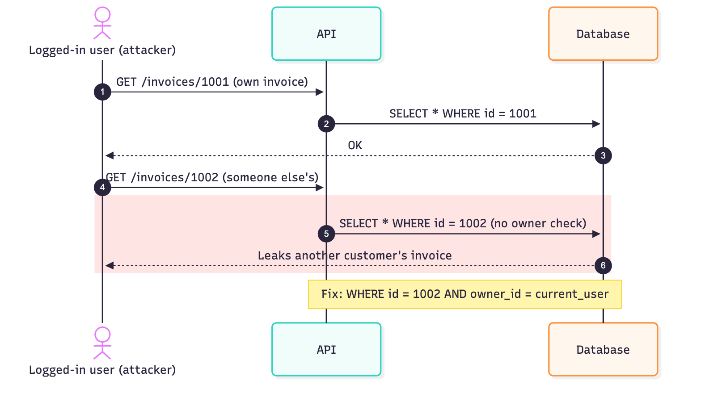
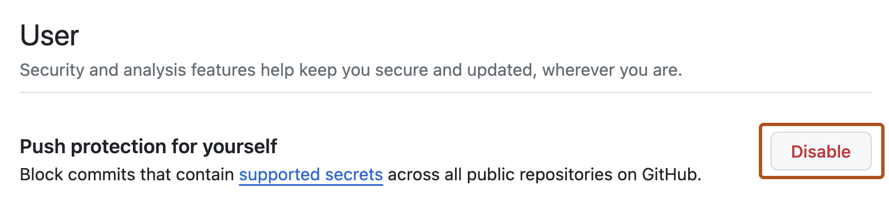
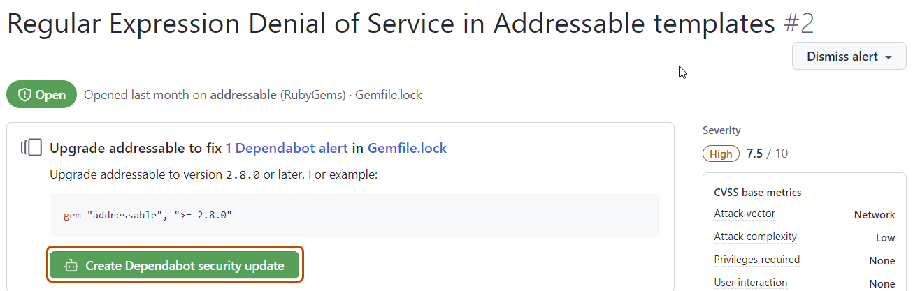

# Part III: DevSecOps & Shift-Left

> Security built into the pipeline and the code. Find bugs before attackers do, and don't give CI more trust than it needs.

_Last reviewed: 2026-10_

[← Supply Chain](02-supply-chain.md) · [Back to handbook](../README.md) · [Next: Access & Infrastructure →](04-access-and-infrastructure.md)

**In this part**

1. [CI/CD pipelines](#1-cicd-pipelines)
2. [Secure coding](#2-secure-coding)
3. [Security testing](#3-security-testing)

---

## 1. CI/CD pipelines

Store credentials as scoped repository, environment or organization secrets, never in workflow files:


*Screenshot: [GitHub Docs](https://docs.github.com/en/actions/security-for-github-actions/security-guides/using-secrets-in-github-actions), CC BY 4.0.*

CI/CD holds your source, secrets, cloud credentials and deploy rights. Compromise it and an attacker can ship malware in every release, with your signature on it.

### Incidents

| Incident | What happened |
|----------|---------------|
| [SolarWinds (2020)](https://www.reversinglabs.com/blog/ci/cd-security-breaches-update-software-security-approach) | Build system backdoored; about 18,000 customers received the trojanized update |
| [Codecov (2021)](https://about.codecov.io/security-update/) | Tampered Bash uploader exfiltrated CI environment variables |
| [PHP git server (2021)](https://www.bleepingcomputer.com/news/security/php-official-git-repository-hacked-code-backdoored/) | Official PHP repo's git server compromised to push a backdoor |
| [Travis CI (2022)](https://www.trendmicro.com/en_us/research/22/j/travis-ci-exposed-secrets-in-public-logs.html) | Secrets exposed in public build logs |
| [CircleCI (2023)](https://circleci.com/blog/january-4-2023-security-alert/) | Internal breach led to theft of customer secrets and keys |
| [tj-actions/changed-files (2025)](https://www.cisa.gov/news-events/alerts/2025/03/18/supply-chain-compromise-third-party-github-action-cve-2025-30066) | Popular GitHub Action compromised to dump secrets from workflow logs |

### Practices

- **Pin third-party actions and tools to a full commit SHA**, not a mutable tag (`uses: actions/checkout@<40-char-sha>`). The tj-actions attack worked because tags were movable.
- **Use short-lived credentials via OIDC** instead of stored cloud keys. GitHub Actions, GitLab and others can mint tokens per job.
- **Least-privilege tokens.** Set `permissions:` explicitly in GitHub Actions (default to `contents: read`).
- **Scope secrets** to the environments and jobs that need them. Use protected branches and environments with required reviewers for production.
- **Treat pull requests from forks as untrusted.** Don't expose secrets to them. Be careful with `pull_request_target` and with interpolating PR titles or branch names into shell commands.
- **Use ephemeral runners.** Rebuild on every job. Don't reuse self-hosted runners across trust levels.
- **Separate pipelines** (and runners) for dev, staging and production, with different privileges.
- **Require signed commits** and review before deploy jobs run.
- **Mask secrets in logs** and audit workflow files and the pipeline's own dependencies.

```yaml
# GitHub Actions: minimal permissions and a pinned action
permissions:
  contents: read
jobs:
  build:
    runs-on: ubuntu-latest
    steps:
      - uses: actions/checkout@b4ffde65f46336ab88eb53be808477a3936bae11 # v4.1.1
```

---

## 2. Secure coding

Functional isn't enough: code has to withstand hostile input. The [OWASP Top 10](https://owasp.org/www-project-top-ten/) lists the most common web risks.

| Practice | What to do |
|----------|------------|
| **Input validation** | Treat all input as untrusted. Validate on the server against an allow-list. |
| **Output encoding** | Encode output for its context (HTML, JS, URL) to prevent XSS. |
| **Parameterized queries** | Never concatenate user input into SQL. Use prepared statements or an ORM. |
| **Authentication and sessions** | Strong auth plus MFA. Use `Secure`, `HttpOnly` and `SameSite` cookies. |
| **Authorization** | Check permissions on every request, server-side, for every object. |
| **Error handling** | Generic errors to users, detailed logs for operators. No stack traces in responses. |
| **Least privilege** | Run services with the minimum rights. Never as root. |

Example: SQL injection.

```python
# ❌ Vulnerable: attacker input becomes SQL
cursor.execute("SELECT * FROM users WHERE username = '" + username + "'")

# ✅ Parameterized query
cursor.execute("SELECT * FROM users WHERE username = ?", (username,))
```

### Broken access control (IDOR)

The top-ranked OWASP risk. The user is logged in, but are they allowed to access *this* object? Authentication answers "who are you"; authorization answers "may you do this".

```python
# ❌ Any logged-in user can read any invoice by changing the ID
@app.get("/invoices/{invoice_id}")
def get_invoice(invoice_id: int, user=Depends(current_user)):
    return db.query(Invoice).get(invoice_id)

# ✅ Scope the query to the caller (or check ownership explicitly)
@app.get("/invoices/{invoice_id}")
def get_invoice(invoice_id: int, user=Depends(current_user)):
    invoice = db.query(Invoice).filter_by(id=invoice_id, owner_id=user.id).first()
    if invoice is None:
        raise HTTPException(404)   # 404, not 403, so IDs can't be enumerated
    return invoice
```



Enforce this centrally (policy layer, middleware, row-level security) rather than remembering it in each handler. Also check *function-level* access: admin endpoints must verify the role, not just hide the button.

### Server-side request forgery (SSRF)

If your server fetches a URL supplied by a user (webhooks, image import, link previews), an attacker can point it at internal services or the cloud metadata endpoint (`http://169.254.169.254/`) and steal credentials.

- Allow-list destination hosts where possible.
- Resolve the hostname, then reject private, loopback and link-local addresses, and re-check after redirects (or disable redirects).
- Require IMDSv2 on AWS, and give workloads minimal roles so a stolen token is worth little.
- Run outbound fetchers in a network segment with restricted egress.

### Injection beyond SQL

| Risk | Don't | Do |
|------|-------|----|
| **OS command injection** | `os.system(f"convert {filename}")` | Pass an argument list: `subprocess.run(["convert", filename], check=True)`. Never use `shell=True` with user input. |
| **Path traversal** | `open("/uploads/" + name)` with `../../etc/passwd` | Resolve the path and verify it stays inside the base directory; generate server-side filenames. |
| **Unsafe deserialization** | `pickle.loads(data)`, `yaml.load()` on untrusted input | Use JSON, or `yaml.safe_load`. Never unpickle data you don't control. |
| **Template injection** | Building templates from user input | Pass user data as template variables only. |
| **XSS** | Insert raw user input with `innerHTML` | Use framework escaping; sanitize any HTML with a vetted library; set a Content-Security-Policy. |

### Authentication details

- **Passwords:** hash with Argon2id, scrypt or bcrypt. Never SHA-256 alone, never reversible encryption. Verify with the library's constant-time compare.
- **Rate-limit and lock out** login, password reset and MFA endpoints. Return the same message whether or not the account exists.
- **Sessions:** rotate the session ID on login, expire idle sessions, invalidate on logout and password change.
- **JWTs:** pin the expected algorithm (reject `none`), validate `exp`, `aud` and `iss`, keep lifetimes short, and don't store secrets in the payload (it's readable).
- **Password reset and invite links:** random, single-use, short-lived tokens, stored hashed.

### Secrets and cryptography

- Use well-reviewed libraries (libsodium, your platform's crypto API). Don't invent algorithms or modes.
- Use the OS CSPRNG (`secrets` in Python, `crypto.randomBytes` in Node), not `Math.random()` or `random`, for tokens and keys.
- Use TLS 1.2+ everywhere, including internal service-to-service traffic. Never disable certificate verification to "make it work".
- Keep keys out of source. See [secrets in `.env` files](01-identity-and-workstation.md#5-keep-secrets-out-of-env-files).

### Web hardening headers

```text
Content-Security-Policy: default-src 'self'
Strict-Transport-Security: max-age=63072000; includeSubDomains
X-Content-Type-Options: nosniff
Referrer-Policy: strict-origin-when-cross-origin
```

Also set cookies with `Secure; HttpOnly; SameSite=Lax` (or `Strict`), and protect state-changing requests against CSRF.

### API and abuse resistance

- Rate-limit and size-limit requests; cap pagination and query complexity (especially GraphQL).
- Validate the schema of every request body and reject unknown fields (mass assignment).
- Don't return more fields than the client needs (excessive data exposure).
- Verify webhook signatures and check timestamps to prevent replay.
- Log security-relevant events (auth failures, permission denials) without logging secrets or personal data.

### Learn more

- [OWASP Cheat Sheet Series](https://cheatsheetseries.owasp.org/): short, practical guides per topic
- [OWASP API Security Top 10](https://owasp.org/API-Security/)
- [OWASP ASVS](https://owasp.org/www-project-application-security-verification-standard/): a checklist for what "secure" means

---

## 3. Security testing

"Shift left" means finding problems at commit and pull-request time, when they are cheap to fix. Automate each of these in CI and block merges on serious findings.

| Type | Finds | Tools |
|------|-------|-------|
| **SAST** (static analysis) | Insecure code patterns in source | [Semgrep](https://semgrep.dev/), SonarQube, CodeQL, Bandit (Python), ESLint security plugins |
| **DAST** (dynamic analysis) | Vulnerabilities in a running app | [OWASP ZAP](https://www.zaproxy.org/), Burp Suite |
| **Dependency scanning** | Known-vulnerable libraries | Dependabot, Renovate, Snyk, `npm audit`, `pip-audit`, OSV-Scanner |
| **Secret scanning** | Keys and tokens in code and history | [Gitleaks](https://github.com/gitleaks/gitleaks), [TruffleHog](https://github.com/trufflesecurity/trufflehog), GitHub push protection |
| **IaC scanning** | Cloud misconfiguration | Checkov, tfsec / Trivy |
| **Container scanning** | OS and library CVEs in images | Trivy, Grype |

GitHub's built-in **push protection** blocks a push that contains a detected secret. You can enable it for your own account, and organizations can enable it for every repository:



*Screenshot: [GitHub Docs](https://docs.github.com/en/code-security/secret-scanning/working-with-secret-scanning-and-push-protection/push-protection-for-users), CC BY 4.0.*

Dependabot alerts show the vulnerable dependency and can open a fix pull request in one click:



*Screenshot: [GitHub Docs](https://docs.github.com/en/code-security/dependabot/dependabot-alerts/viewing-and-updating-dependabot-alerts), CC BY 4.0.*

Quick start for secret scanning as a pre-commit hook:

```bash
brew install gitleaks
gitleaks protect --staged   # run before each commit (or wire it into pre-commit)
```

If a scanner finds a real secret, **rotate it first**, then clean up Git history.

### Further reading

- [OWASP Web Security Testing Guide](https://owasp.org/www-project-web-security-testing-guide/)
- [NIST Secure Software Development Framework (SP 800-218)](https://csrc.nist.gov/pubs/sp/800/218/final)
- [GitHub code security docs](https://docs.github.com/en/code-security)
- [Microsoft Security Development Lifecycle](https://www.microsoft.com/en-us/securityengineering/sdl)
- [OWASP ZAP documentation](https://www.zaproxy.org/docs/)

---

[← Supply Chain](02-supply-chain.md) · [Back to handbook](../README.md) · [Next: Access & Infrastructure →](04-access-and-infrastructure.md)
