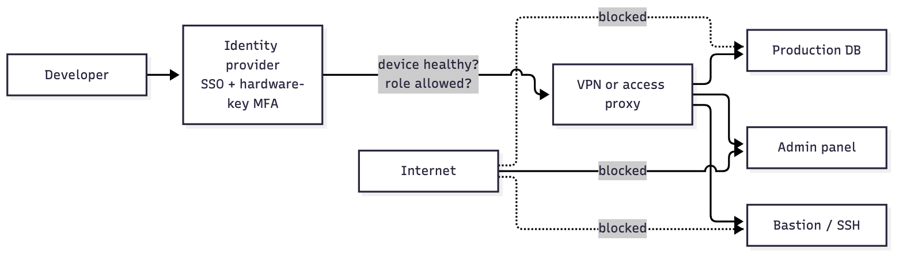
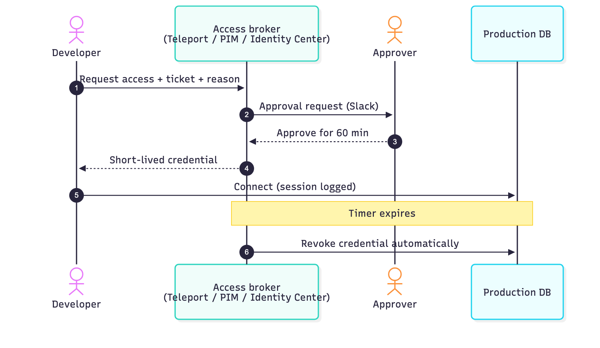
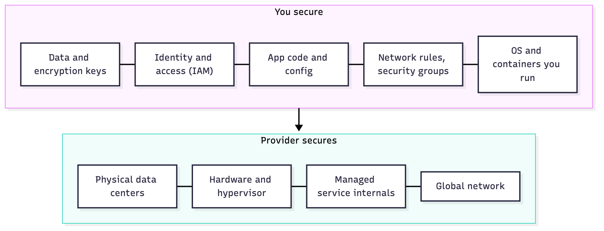

# Part IV: Access & Infrastructure

> Who can reach what, and for how long. Shrink the blast radius: no standing production access, no flat networks, no permanent cloud admins.

_Last reviewed: 2026-10_

[← DevSecOps](03-devsecops.md) · [Back to handbook](../README.md) · [Next: Detect & Respond →](05-detect-and-respond.md)

**In this part**

1. [VPN and MFA for critical resources](#1-vpn-and-mfa-for-critical-resources)
2. [Just-in-time (JIT) privileges](#2-just-in-time-jit-privileges)
3. [Cloud security](#3-cloud-security)

---

## 1. VPN and MFA for critical resources



Critical systems (production, databases, admin panels) should not be reachable from the open internet. Put them behind a VPN or an identity-aware access proxy, and require MFA to get in.

**VPN access**

- Require MFA on the VPN itself: a hardware key or passkey if supported, otherwise TOTP (Google Authenticator, Authy, 1Password). Avoid SMS.
- Use SSO so offboarding someone removes VPN access at the same time as everything else.
- Prefer per-service access (e.g. [Tailscale](https://tailscale.com/), [Teleport](https://goteleport.com/), Cloudflare Access) over "VPN gives you the whole network".

**MFA is mandatory on:**

- [ ] Cloud accounts (AWS, GCP, Azure), including the root account
- [ ] Source control (GitHub, GitLab). Enforce it at the organization level.
- [ ] Internal dashboards and admin panels
- [ ] Email, password manager, domain registrar

More: [UK NCSC secure development and deployment guidance](https://github.com/ukncsc/secure-development-and-deployment)

---

## 2. Just-in-time (JIT) privileges



Developers often keep standing access to production databases, cloud consoles and CI secrets "just in case". If their account or laptop is compromised, the attacker inherits all of it.

JIT access grants elevated permissions temporarily, on request, with approval, and revokes them automatically.

| Option | How it works |
|--------|--------------|
| **AWS IAM Identity Center** | Sign in via your IdP (Okta, Entra ID), assume a permission set for a short session (e.g. 1 hour) |
| **Azure PIM** | Request an eligible role (e.g. Key Vault Contributor) with justification, MFA and approval; auditable |
| **Teleport Access Requests** | Request SSH, Kubernetes or database access via Slack, Jira or web; expires after a set time |
| **StrongDM / HashiCorp Boundary** | Identity-based session brokering so users never handle raw credentials |

Example flow: a developer requests production DB access with a ticket reference, a manager approves in Slack, access expires in 60 minutes, and the session is logged.

Rollout order: start with production databases and cloud admin roles, then secrets stores, then everything else.

---

## 3. Cloud security



Cloud providers secure the infrastructure. **You** secure your configuration, identities, data and applications. Most cloud breaches come from misconfiguration, not from the provider.

| Area | Practice |
|------|----------|
| **IAM** | Least privilege. Use roles and groups, not long-lived user keys. MFA on root and all human users. Review unused permissions regularly. |
| **Network** | Private subnets by default. Tight security groups. Don't expose databases or admin ports to `0.0.0.0/0`. |
| **Encryption** | Encrypt at rest (KMS, Key Vault) and in transit (TLS). Manage keys with rotation and access policies. |
| **Logging** | Turn on CloudTrail / Azure Monitor / Cloud Audit Logs in every account and region. Alert on suspicious activity. |
| **IaC** | Scan Terraform and CloudFormation with Checkov or Trivy before apply. |
| **Data exposure** | Enable account-level S3 Block Public Access. |

Example: restricting S3 access.

```jsonc
// ❌ Bad: anyone on the internet can read the objects
{
  "Effect": "Allow",
  "Principal": "*",
  "Action": "s3:GetObject",
  "Resource": "arn:aws:s3:::my-bucket/*"
}

// ✅ Good: only a specific IAM role can read them
{
  "Effect": "Allow",
  "Principal": { "AWS": "arn:aws:iam::123456789012:role/my-role" },
  "Action": "s3:GetObject",
  "Resource": "arn:aws:s3:::my-bucket/*"
}
```

### Resources

| Topic | AWS | Azure | GCP |
|-------|-----|-------|-----|
| IAM | [Best practices](https://docs.aws.amazon.com/IAM/latest/UserGuide/best-practices.html) | [RBAC](https://learn.microsoft.com/en-us/azure/role-based-access-control/overview) | [IAM overview](https://cloud.google.com/iam/docs) |
| Network | [VPC security](https://docs.aws.amazon.com/vpc/latest/userguide/VPC_Security.html) | [Network best practices](https://learn.microsoft.com/en-us/azure/security/fundamentals/network-best-practices) | [VPC best practices](https://cloud.google.com/vpc/docs/best-practices) |
| Encryption | [Encryption options](https://docs.aws.amazon.com/whitepapers/latest/introduction-aws-security/encryption.html) | [Encryption overview](https://learn.microsoft.com/en-us/azure/security/fundamentals/encryption-overview) | [Encryption at rest](https://cloud.google.com/security/encryption-at-rest) |
| Logging | [CloudTrail](https://docs.aws.amazon.com/awscloudtrail/latest/userguide/cloudtrail-user-guide.html) | [Azure Monitor](https://learn.microsoft.com/en-us/azure/azure-monitor/overview) | [Cloud Operations](https://cloud.google.com/products/operations) |

IaC security: [Checkov](https://www.checkov.io/), [Trivy](https://github.com/aquasecurity/trivy), [Terraform security tutorials](https://developer.hashicorp.com/terraform/tutorials/security/overview)

---

[← DevSecOps](03-devsecops.md) · [Back to handbook](../README.md) · [Next: Detect & Respond →](05-detect-and-respond.md)
