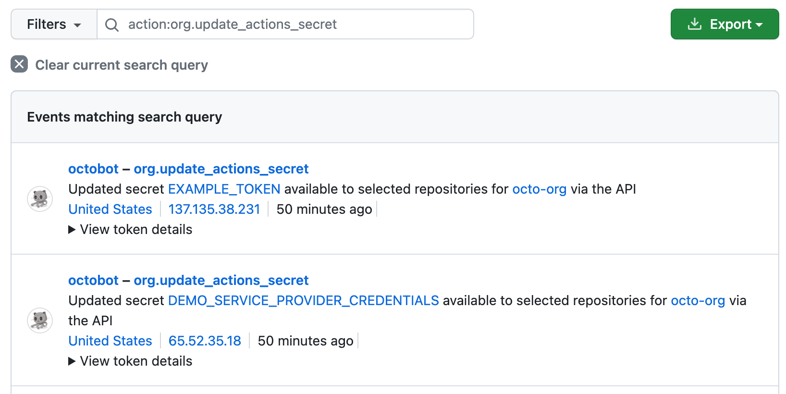
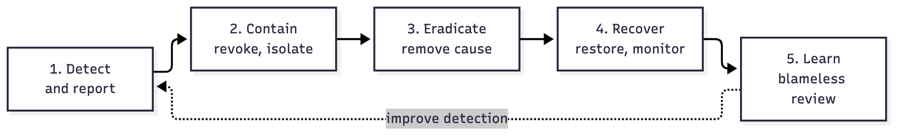

# Part V: Detect & Respond

> Assume breach. The question isn't whether something slips through, but how fast you see it and how cleanly you contain it.

_Last reviewed: 2026-10_

[← Access & Infrastructure](04-access-and-infrastructure.md) · [Back to handbook](../README.md) · [Next: AI-Assisted Development →](06-ai-assisted-development.md)

**In this part**

1. [Logging and alerting](#1-logging-and-alerting)
2. [Incident response](#2-incident-response)

---

## 1. Logging and alerting

Example: GitHub's audit log, filtered to organization secret changes:

*Screenshot: [GitHub Docs](https://docs.github.com/en/actions/security-for-github-actions/security-guides/security-hardening-for-github-actions), CC BY 4.0.*

Attackers often stay undetected for weeks. Good logs and alerts are what shorten that window. You can't defend what you can't see.

Centralize logs from developer machines, cloud accounts, GitHub and CI in a SIEM (Security Information and Event Management) so you can:

- Spot lateral movement across machines and infrastructure.
- Correlate developer activity with signals from AWS GuardDuty, GitHub audit logs and similar sources.
- Alert on anomalies, such as:
  - `scp` or large uploads at 3 AM
  - A Git push or cloud login from an unfamiliar IP or country
  - New SSH keys, deploy keys or personal access tokens added to an org
  - Disabled MFA or logging, or a new admin role
  - A production secret read by a user who never used it before

**Start small:** pick five high-value alerts, route them to a channel someone watches, and write down who responds. Add more once those are tuned.

### References

**Logging and SIEM**

- [NIST SP 800-92: Guide to Computer Security Log Management](https://csrc.nist.gov/publications/detail/sp/800-92/final)
- [Introduction to SIEM (Rapid7)](https://www.rapid7.com/fundamentals/siem/)
- [Elastic SIEM overview](https://www.elastic.co/what-is/siem)
- [Wazuh documentation](https://documentation.wazuh.com/current/index.html): open-source SIEM and XDR
- [Graylog log management best practices](https://go2.graylog.org/rs/graylog/images/Graylog_Security_Log_Management_Best_Practices.pdf)

**Detection tools**

- [Falco](https://falco.org/): runtime threat detection for containers and Linux hosts
- [osquery](https://osquery.io/): query endpoints like a database (processes, users, network)
- [MITRE ATT&CK](https://attack.mitre.org/): map attacker behavior to detections

---

## 2. Incident response

Every system can be breached. What separates a bad day from a disaster is whether you planned. The model below follows [NIST SP 800-61r2](https://csrc.nist.gov/publications/detail/sp/800-61/rev-2/final).

| Phase | Goal | Examples |
|-------|------|----------|
| **1. Detect and report** | Recognize and escalate quickly | Unusual behavior, monitoring alerts. Report to security immediately. |
| **2. Contain** | Stop the spread | Disconnect the host, revoke tokens and sessions, rotate exposed credentials |
| **3. Eradicate** | Remove the cause | Patch the vulnerability, remove malware and persistence |
| **4. Recover** | Return to normal safely | Restore from clean backups, monitor for recurrence |
| **5. Learn** | Improve | Blameless post-incident review with concrete follow-ups |

### If you suspect your laptop or account is compromised

1. **Stop and disconnect** the device from the network. Don't wipe it yet, because it holds evidence.
2. **Tell security / your lead immediately.** Reporting fast is never punished.
3. From a clean device, **revoke and rotate**: GitHub sessions and SSH keys, cloud credentials, API tokens, password manager, email.
4. **Review recent activity** (GitHub audit log, cloud logs) for actions you didn't take.
5. Leave the device for IT to reimage.

### Runbooks

Short, specific steps for the incidents developers actually hit. Copy them into your internal wiki and fill in your own systems and contacts.

#### A secret was leaked (pushed to Git, pasted in chat, exposed in logs)

1. **Rotate first.** Deleting the commit doesn't help: bots scrape public repos within minutes, and the secret exists in clones and forks. Revoke the key, token or password and issue a new one.
2. **Check usage.** Search the provider's audit logs (CloudTrail, GitHub audit log, API dashboard) for activity from unknown IPs or at unusual times, from the moment of exposure.
3. **Clean up history** with `git filter-repo` or BFG if the repo is private and you need to. Treat the secret as burned regardless.
4. **Prevent recurrence:** secret scanning and push protection, and move the secret to a [secrets manager](01-identity-and-workstation.md#5-keep-secrets-out-of-env-files).

#### A malicious or compromised dependency was installed

1. **Isolate** the machine or CI runner. Stop any running pipeline using that package.
2. **Identify** the package, versions and when it was installed (`git log` on the lockfile, CI logs).
3. **Assume secrets present at install time are stolen:** environment variables, `~/.ssh`, `~/.aws`, npm and GitHub tokens, browser sessions. Rotate all of them from a clean machine.
4. **Check for persistence and spread:** new SSH keys, GitHub Actions or workflow files you didn't add, new npm tokens, unexpected package publishes from your account.
5. **Remove** the package, pin to a known-good version, rebuild from a clean environment.
6. **Report** it to the registry (npm, PyPI) and to your team.

#### Laptop lost or stolen

1. Report to IT/security immediately.
2. Remote lock or wipe the device (MDM).
3. Revoke SSO sessions, GitHub SSH keys and tokens, and VPN certificates for that device.
4. If disk encryption was on and the device was locked, risk is low. If not, treat all stored credentials as exposed and rotate.
5. Revoke hardware-key registrations only if the key was lost with the laptop.

#### A production account or cloud credential was compromised

1. **Contain:** disable or rotate the credential, attach a deny-all policy to the affected role or user, and revoke active sessions.
2. **Preserve evidence:** snapshot affected instances and export logs *before* you terminate anything.
3. **Scope:** what did the identity access? Check for new users, access keys, roles, security-group changes, unfamiliar resources (cryptominers are common), and data egress.
4. **Eradicate:** remove attacker-created resources and persistence. Rotate every secret the identity could read.
5. **Notify** leadership, and legal or compliance if customer data may be involved. Some rules have notification deadlines (for example GDPR's 72 hours).

#### Roles during an incident

| Role | Responsibility |
|------|----------------|
| **Incident lead** | Makes decisions, keeps the timeline, decides when it's over |
| **Investigator** | Analyses logs and systems, identifies scope and cause |
| **Communicator** | Updates stakeholders on a fixed schedule (internal and, if needed, customers) |
| **Scribe** | Records actions and timestamps in a shared doc as they happen |

On a small team one person may hold several roles, but write the roles down in advance.

#### After the incident

Hold a blameless review within a week. Capture: timeline, how it was detected, what worked, root cause, and **follow-up actions with owners and dates**. Share what you learn.

### Prepare before you need it

- Keep an up-to-date contact list and on-call path for security incidents.
- Know how to revoke the most important credentials quickly (a short runbook per system).
- Keep tested, offline or immutable backups.
- Run a tabletop exercise at least once a year.

### Frameworks and playbooks

- [NIST SP 800-61r2](https://csrc.nist.gov/publications/detail/sp/800-61/rev-2/final)
- [SANS Incident Handler's Handbook](https://www.sans.org/white-papers/1741/)
- [MITRE ATT&CK](https://attack.mitre.org/): map attacker tactics and techniques during forensics
- [AWS Incident Response Guide](https://docs.aws.amazon.com/securityhub/latest/userguide/securityhub-ir.html)
- [Google Cloud incident response](https://cloud.google.com/security/incident-response)
- [Microsoft incident response overview](https://learn.microsoft.com/en-us/security/compass/incident-response-overview)

### Open-source toolkits

- [GRR Rapid Response](https://github.com/google/grr): remote live forensics
- [TheHive + Cortex](https://thehive-project.org/): collaborative incident handling
- [Zeek](https://zeek.org/): network traffic analysis

---

[← Access & Infrastructure](04-access-and-infrastructure.md) · [Back to handbook](../README.md) · [Next: AI-Assisted Development →](06-ai-assisted-development.md)
