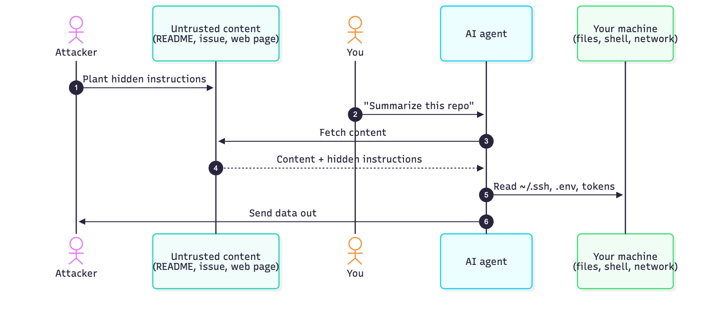
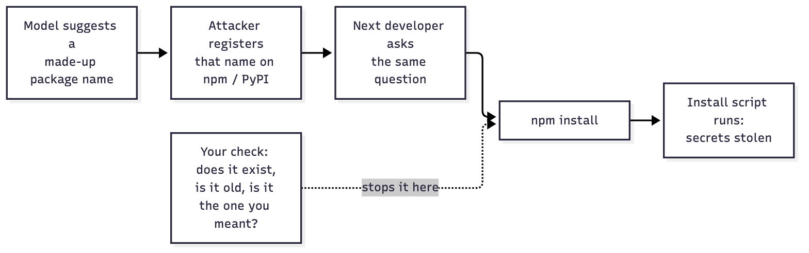
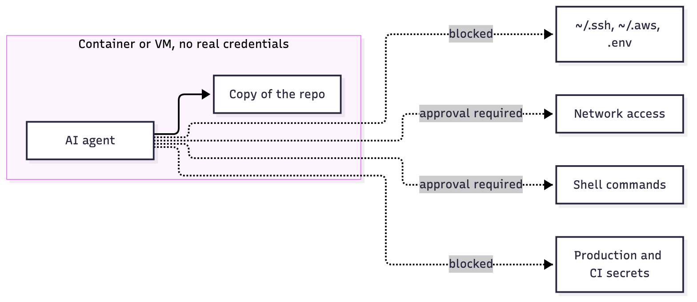

# Part VI: AI-Assisted Development

> Coding assistants and agents read your files, run shell commands and install packages on your behalf. That makes them a new, powerful way to reach your secrets. Treat an agent like a fast junior with your credentials: useful, but not trusted by default.

_Last reviewed: 2026-10_

[← Detect & Respond](05-detect-and-respond.md) · [Back to handbook](../README.md) · [Next: People & Process →](07-people-and-process.md)

**In this part**

1. [What changes with AI tools](#1-what-changes-with-ai-tools)
2. [Prompt injection](#2-prompt-injection)
3. [Malicious MCP servers, skills and rules files](#3-malicious-mcp-servers-skills-and-rules-files)
4. [Hallucinated packages (slopsquatting)](#4-hallucinated-packages-slopsquatting)
5. [Secrets and data you give to a model](#5-secrets-and-data-you-give-to-a-model)
6. [Agent permissions and review](#6-agent-permissions-and-review)
7. [Checklist](#7-checklist)

---

## 1. What changes with AI tools

An assistant that can read files, call tools and run commands has the same reach as you. Anything that can influence its input can influence its actions.

| Old assumption | New reality |
|----------------|-------------|
| Code only runs when I run it | An agent runs commands, installs packages and edits files for you |
| A README is just text | A README, issue, web page or PDF can contain instructions the model follows |
| Dependencies come from a registry I chose | The model may suggest a package that doesn't exist, or that an attacker registered |
| My secrets stay on my machine | Anything in the model's context may be sent to a third party, and an agent can read `~/.aws` as easily as you can |
| I review the code I merge | Generated code looks plausible, so reviews get shallower |

Malware has already started using these tools. In the August 2025 [s1ngularity attack on Nx](https://orca.security/resources/blog/s1ngularity-supply-chain-attack/), the malicious package invoked locally installed AI CLIs with permission-bypass flags (`--yolo`, `--trust-all-tools`, `--dangerously-skip-permissions`) and had them hunt for secrets to exfiltrate. The agent's broad access was the weapon.

---

## 2. Prompt injection

A model can't reliably tell your instructions from instructions hidden in the data it reads. This is **indirect prompt injection**: the attacker never talks to your assistant, they just put text where it will look.



Typical hiding places: HTML comments, white-on-white text, zero-width Unicode characters, image alt text, issue and PR comments, package READMEs, and tool descriptions.

### Defenses

- **Separate reading from acting.** An agent that browses untrusted content should not also hold shell access and secrets in the same session.
- **Deny by default** for network access and for reading credential paths (`~/.ssh`, `~/.aws`, `~/.config/gh`, browser profiles).
- **Require approval for side effects:** shell commands, file writes outside the repo, network calls, git push, sending messages.
- **Watch for exfiltration channels:** outbound HTTP, rendered markdown images or links containing data, commits to public repos, emails.
- **Run on untrusted code in a sandbox** (container, VM, or a separate OS user) with no access to your real credentials.
- **Assume a successful injection** is possible and limit the damage, rather than relying on the model to refuse.

---

## 3. Malicious MCP servers, skills and rules files

Anything that adds instructions or tools to your assistant is code you're installing, so apply the [dependency rules](02-supply-chain.md#1-dependencies).

| Vector | What goes wrong | Example |
|--------|-----------------|---------|
| **MCP server** | Runs with your permissions, sees tool inputs, and can silently change behavior in an update | [`postmark-mcp`](https://thehackernews.com/2025/09/first-malicious-mcp-server-found.html): a look-alike npm package that was clean for 15 versions, then added a hidden BCC on every email it sent |
| **Rules file / `AGENTS.md` / `CLAUDE.md` / `.cursorrules`** | Instructions that steer the model's code generation for everyone on the repo | [Rules File Backdoor](https://securityaffairs.com/175593/hacking/rules-file-backdoor-ai-code-editors-silent-supply-chain-attacks.html): hidden zero-width and bidirectional Unicode in rules files made assistants insert malicious code |
| **Skills, plugins, extensions** | Bundled scripts and instructions, often auto-loaded | Same risk as any package |
| **Tool descriptions** | A server can change a tool's description after you approved it ("rug pull") | Re-review after updates |

### Practices

- Install MCP servers and plugins only from **publishers you can verify**. Check the repo, maintainers, and that the package name matches the official project (a name on npm is not proof of origin).
- **Pin versions** and review changes on upgrade, just as with any dependency.
- Give each server the **least privilege**: read-only tokens, a scoped directory, no shell.
- **Review rules and config files in pull requests like code.** Look for hidden characters:

  ```bash
  # Flag zero-width and bidi control characters in tracked text files
  git grep -nP '[\x{200B}-\x{200F}\x{202A}-\x{202E}\x{2066}-\x{2069}\x{FEFF}]'
  ```

- Treat a **cloned repo's** agent config (`.claude/`, `.cursor/`, `.mcp.json`) as untrusted until you've read it. Don't open unknown repos with an agent that auto-loads project config and tools.
- Keep a list of what's installed, and remove what you don't use.

---

## 4. Hallucinated packages (slopsquatting)

Models sometimes recommend packages that don't exist. Attackers can register those names and wait. A USENIX Security 2025 study, as [summarized by CSA](https://labs.cloudsecurityalliance.org/research-rb/csa-research-note-slopsquatting-ai-coding-assistant-supply-c/), found hallucinated names in roughly 5% of samples from commercial models and over 20% from open-source ones, and many repeated across runs, which is what makes pre-registering them practical. An early proof of concept, an empty package named `huggingface-cli`, drew tens of thousands of downloads.



"The package exists" is not enough, because the attacker made it exist.

### Practices

- **Verify every package the model suggests**: age, download history, maintainers, linked repo, and whether it matches what you asked for.
- Prefer well-known libraries you can name yourself. If you don't recognize it, look it up before installing.
- Install in a throwaway container when evaluating something unfamiliar, with `ignore-scripts` on.
- Let your lockfile and CI [dependency checks](03-devsecops.md#3-security-testing) catch new, young or low-reputation packages.

---

## 5. Secrets and data you give to a model

- **Don't paste secrets** (keys, tokens, `.env` contents, customer data) into chat prompts, issues or screenshots. Anything sent is stored by someone else and may be logged.
- **Keep secrets out of the agent's reach.** Don't leave long-lived credentials in the repo, in env vars of the agent's shell, or in files in its working directory. Use [runtime injection](01-identity-and-workstation.md#5-keep-secrets-out-of-env-files) with short-lived, scoped tokens.
- **Exclude sensitive paths** with your tool's ignore or permission settings (`.env*`, key files, `terraform.tfstate`, customer data dumps).
- **Know your tool's data policy.** Which plan retains prompts, whether they train on them, and who in your org can see them. Prefer enterprise or zero-retention settings for company code.
- **Don't give the agent your cloud admin session.** Use a separate, narrowly scoped identity for any automation.
- If a secret was exposed to a model or pasted in a prompt, treat it as leaked and [rotate it](05-detect-and-respond.md#2-incident-response).

---

## 6. Agent permissions and review

### Permissions

- **Never disable permission prompts on a machine that holds real credentials.** Flags like `--dangerously-skip-permissions`, `--yolo` and `--trust-all-tools` exist for disposable sandboxes only. Malware already abuses them.
- Use **allow-lists** for commands you trust (`git status`, `npm test`) and block destructive ones (`rm -rf`, `git push --force`, `curl | sh`, `terraform apply`, anything touching production).
- Run autonomous or long-running agents in a **container or VM** with a copy of the repo, no credentials, and restricted egress.
- Give agents **separate Git credentials** that can only push to branches and can't touch protected branches, releases or CI secrets.
- **Log what agents do.** Keep command history and tool-call logs so you can reconstruct events after an incident.



### Reviewing generated code

AI-generated code is untrusted input from a very confident author. Review it as you would a pull request from an unknown contributor.

- Read the diff. Don't merge what you didn't understand.
- Look specifically for: new dependencies, network calls, shell execution, disabled TLS or auth checks, hardcoded keys, broad IAM permissions, `eval`, and weakened validation.
- Make the safe path the default with [SAST, secret scanning and dependency checks](03-devsecops.md#3-security-testing) in CI. A model that writes insecure code at speed needs checks that run at speed.
- Write tests for security behavior (auth, authorization, input handling) yourself or review them carefully, since models tend to write tests that pass.

---

## 7. Checklist

- [ ] Agents run with approvals on; no bypass flags outside a sandbox
- [ ] Credentials aren't readable from the agent's working environment
- [ ] MCP servers, plugins and skills are from verified publishers, pinned, and reviewed on update
- [ ] Rules and agent config files are reviewed in PRs and scanned for hidden characters
- [ ] Every AI-suggested package is verified before install
- [ ] No secrets or customer data are pasted into prompts
- [ ] Untrusted repos and content are opened in a sandbox, not in your main session
- [ ] AI-generated code goes through the same review and CI checks as human code

### Further reading

- [OWASP Top 10 for LLM Applications](https://genai.owasp.org/llm-top-10/)
- [CISA: Widespread supply chain compromise impacting npm](https://www.cisa.gov/news-events/alerts/2025/09/23/widespread-supply-chain-compromise-impacting-npm-ecosystem) (the Shai-Hulud worm, which spread by stealing developer tokens)
- [NIST AI Risk Management Framework](https://www.nist.gov/itl/ai-risk-management-framework)

---

[← Detect & Respond](05-detect-and-respond.md) · [Back to handbook](../README.md) · [Next: People & Process →](07-people-and-process.md)
