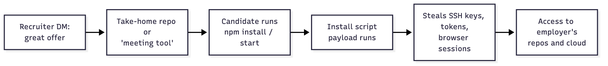
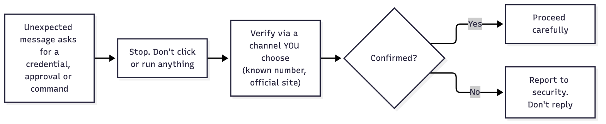
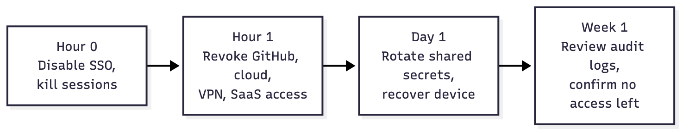

# Part VII: People & Process

> Most attacks on developers start with a conversation, not an exploit. This part covers social engineering, phone and account recovery, and the joiner and leaver processes that keep access tidy.

_Last reviewed: 2026-10_

[← AI-Assisted Development](06-ai-assisted-development.md) · [Back to handbook](../README.md)

**In this part**

1. [Fake recruiters and "coding challenges"](#1-fake-recruiters-and-coding-challenges)
2. [Other social engineering patterns](#2-other-social-engineering-patterns)
3. [Phone, SIM-swap and account recovery](#3-phone-sim-swap-and-account-recovery)
4. [Onboarding and offboarding](#4-onboarding-and-offboarding)

---

## 1. Fake recruiters and "coding challenges"

A well-documented campaign, tracked by Palo Alto Unit 42 as [Contagious Interview](https://unit42.paloaltonetworks.com/two-campaigns-by-north-korea-bad-actors-target-job-hunters/) and attributed to North Korean operators, targets developers directly:

1. A "recruiter" contacts you on LinkedIn or Telegram with an attractive role.
2. They send a take-home test, a Git repo, or a "video call" that needs a special tool.
3. You run `npm install` or `npm start`, or install the "meeting app". A malicious dependency or install script runs, then steals browser data, SSH keys, tokens and wallet files.

Researchers have found [hundreds of malicious npm packages](https://www.bleepingcomputer.com/news/security/new-wave-of-fake-interviews-use-35-npm-packages-to-spread-malware/) built for this campaign, so it's a continuing operation and not a one-off.

The danger to **your employer** is often larger than to you: a laptop you also use for work, or a work laptop used for a side interview, gives the attacker a foothold in company systems.

### What to do

- **Never run a stranger's code on a machine that has your real credentials.** Use a disposable VM, a container, or a cloud dev environment (Codespaces, Gitpod) with nothing sensitive in it.
- **Read the repo first.** Check `package.json` scripts (`preinstall`, `postinstall`, `prepare`), obfuscated files, and odd network calls. Install with `npm install --ignore-scripts`.
- **Verify the recruiter and company** through the company's official site and careers page, not through links they send. Check profile age, connections and whether the role exists.
- **Refuse unusual tooling.** A real interview doesn't need you to install an unknown app, run a binary, or "fix" a failing screen-share by running a command.
- **Be suspicious of urgency and flattery.** Pressure to skip steps, or to run the code immediately, is a warning sign.
- **Keep work and personal separate.** No interviews or side projects on the work laptop.
- If you ran something suspicious, **tell your security contact immediately** and follow the [compromise steps](05-detect-and-respond.md#if-you-suspect-your-laptop-or-account-is-compromised).

---

## 2. Other social engineering patterns

| Pattern | What it looks like | Response |
|---------|--------------------|----------|
| **Fake IT / helpdesk** | "We need your MFA code / to reset your password" by phone or chat | IT never asks for codes. Hang up and call back through a known number. |
| **MFA fatigue** | Dozens of push prompts at 3 AM until you tap Approve | Deny, report it, and change your password. Prefer FIDO2 keys, which don't have approve-by-tap prompts. |
| **Executive impersonation** | "Urgent, I'm in a meeting. Buy gift cards / grant access" | Verify out-of-band before any access or money change. |
| **Fake security alert** | "Your GitHub account is compromised, click to secure it" | Go to the site yourself. Never use the link. |
| **Malicious OAuth app** | "Authorize this app to read your repos" | Check the publisher and requested scopes. Revoke unneeded apps in settings. |
| **Fake `npm` or GitHub notices** | Phishing mails posing as an MFA update to steal registry tokens (this started the [Shai-Hulud worm](https://www.cisa.gov/news-events/alerts/2025/09/23/widespread-supply-chain-compromise-impacting-npm-ecosystem)) | Use phishing-resistant MFA. Verify the sender and the URL. |
| **Support-ticket or issue-comment bait** | Comments with links to "fixes" that are malware | Don't run commands from untrusted comments. |
| **"ClickFix" prompts** | A web page says "press Win+R and paste this to fix the error" | Never paste commands you don't understand. |

**Universal rule:** if a message creates urgency and asks for a credential, an approval or a command, stop. Verify using a channel you chose.

---

## 3. Phone, SIM-swap and account recovery

Attackers go after your phone number because it's the recovery path for everything else.

- **Carrier PIN or port-out lock.** Ask your carrier to require a PIN to port your number or change your SIM, and to block SIM changes without in-person ID.
- **Don't use SMS as a second factor** where you have a choice. Use [hardware keys or passkeys](01-identity-and-workstation.md#3-passwords-mfa-and-passkeys), or an authenticator app.
- **Don't let your phone number be the only recovery option.** Set up recovery codes (stored in your password manager) and a second hardware key.
- **Protect your email.** Whoever controls your inbox can reset almost everything. It needs your strongest MFA.
- **Lock down the phone itself.** Strong passcode, auto-lock, OS updates, and no sideloaded apps. Your authenticator and messaging apps live there.
- **Limit what's public.** Your number, birthday and employer are all useful for pretexting.
- **Know the signs of a SIM swap:** sudden loss of service, "SIM changed" alerts, or password-reset mail you didn't request. Contact the carrier immediately and rotate credentials from a clean device.

---

## 4. Onboarding and offboarding

Access that's granted ad hoc and never removed is how breaches grow. Make both directions a checklist.

### Onboarding (day one)

The full, copyable list is in [`checklists/onboarding.md`](../checklists/onboarding.md). Highlights:

- Managed, encrypted device with EDR and an auto-updating OS
- Password manager, hardware-key MFA enrolled (two keys), recovery codes stored
- SSO account, with MFA enforced on GitHub, cloud, and email
- SSH or signing key set up (preferably hardware-backed)
- Least-privilege access: only what the role needs, with a ticket and an owner
- Security basics walkthrough and the incident contact info

### Offboarding (same day)

The full list is in [`checklists/offboarding.md`](../checklists/offboarding.md). Highlights:

- Disable SSO and identity-provider account first (this cuts most access at once)
- Revoke GitHub org membership, personal access tokens, SSH and deploy keys, and OAuth apps
- Revoke cloud access and rotate any **shared** secrets they could read (database passwords, API keys, signing keys, Wi-Fi)
- Remove from VPN, bastion, CI, monitoring, package registries and vendor SaaS
- Recover and wipe the device
- Review recent activity for anything unusual

### Principles

- **One identity per person** (SSO), so leaving is one click, not twenty.
- **No shared accounts.** If you can't tell who did something, you can't investigate it.
- **Access reviews** every quarter: who has production, admin, and secrets access, and do they still need it?
- **Contractors get the same treatment** with an expiry date set at the start.

---

[← AI-Assisted Development](06-ai-assisted-development.md) · [Back to handbook](../README.md)
